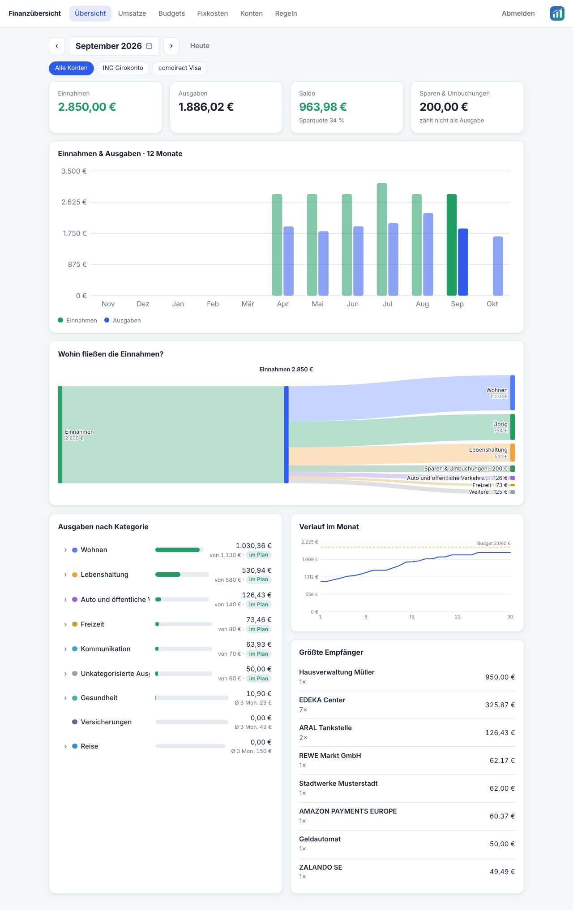
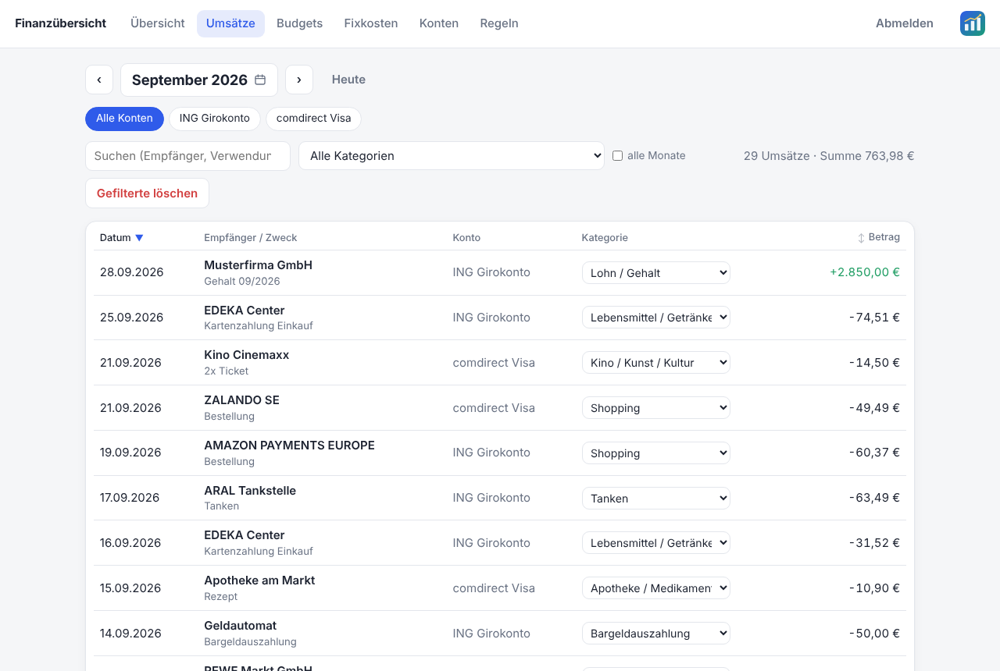
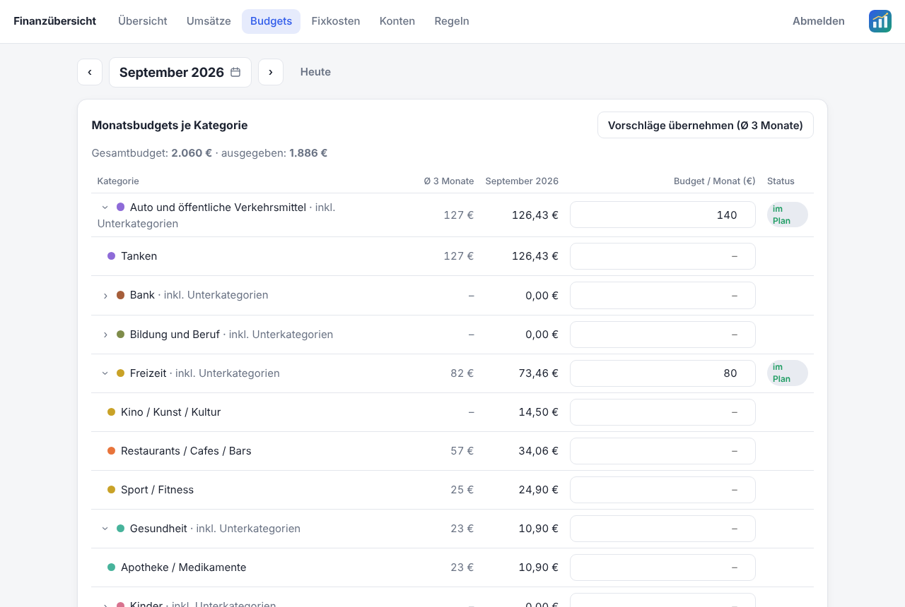
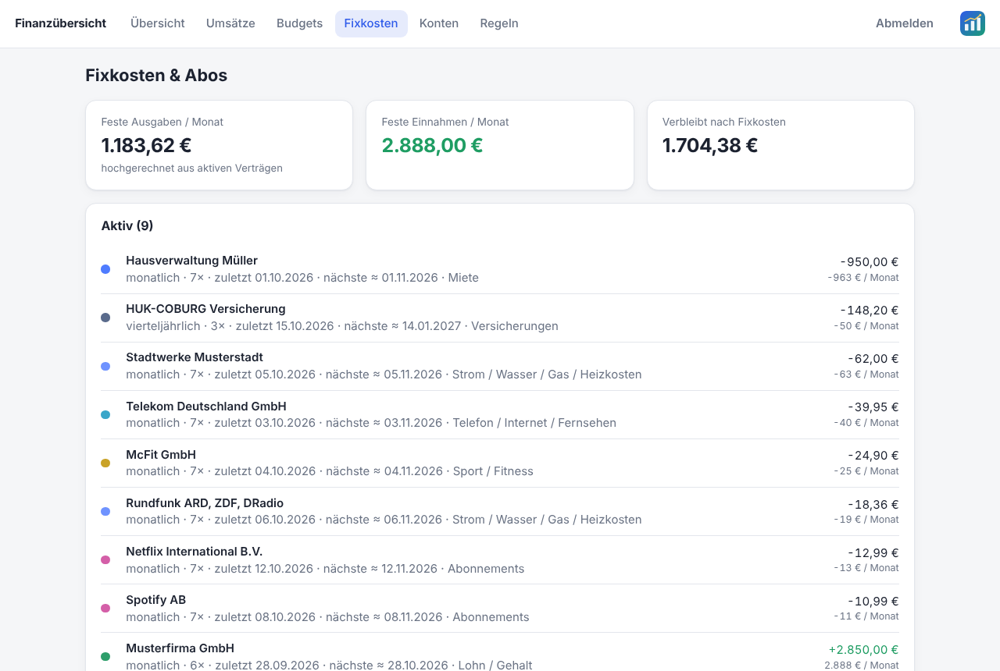
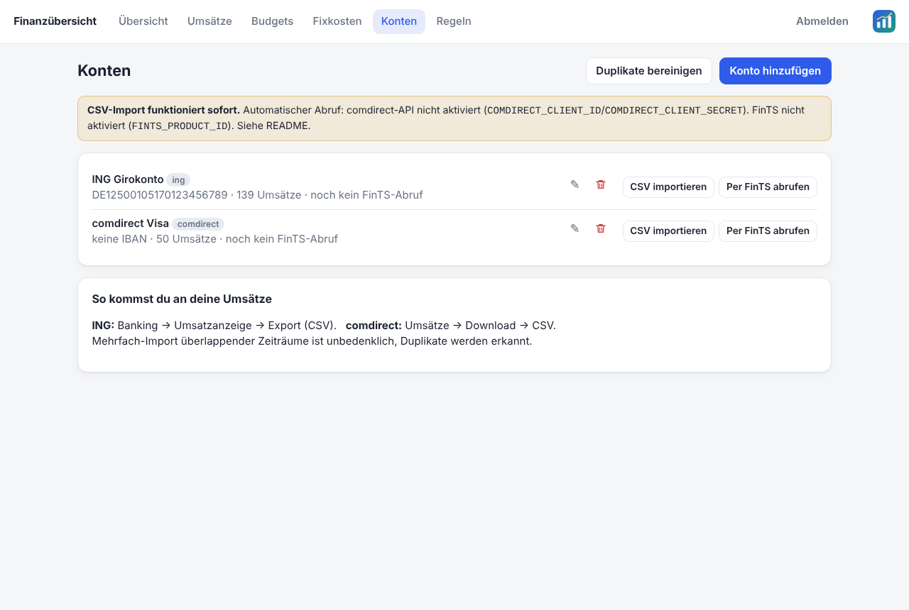
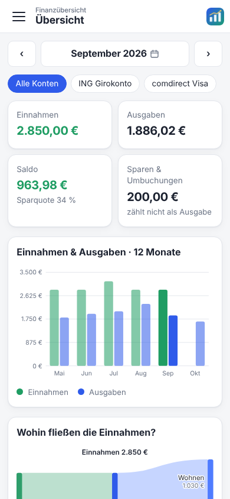
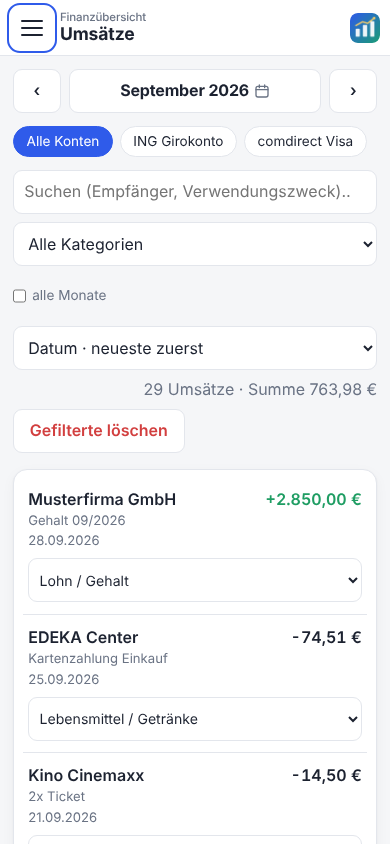
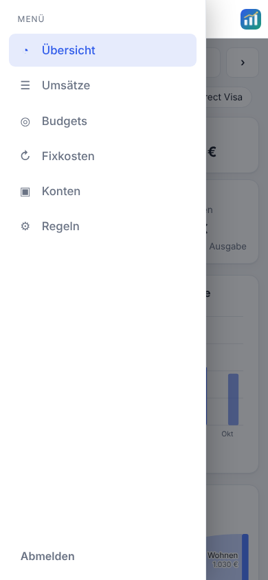

# FinTrack – selbst gehostete Finanzübersicht

Konten von **ING** und **comdirect** einlesen, Umsätze automatisch kategorisieren, Budgets und Fixkosten auswerten.
Alle Daten liegen in einer lokalen SQLite-Datei – keine Cloud, keine Weitergabe.

Läuft als **Home-Assistant-Add-on** (empfohlen) oder eigenständig mit Docker.

## Screenshots

Alle Bilder zeigen frei erfundene Beispieldaten (`fintrack/tests/samples/`).



| Umsätze | Budgets |
|---|---|
|  |  |
| **Fixkosten** | **Konten** |
|  |  |

Mobil optimiert (Burger-Menü, Datepicker für Monat oder ganzes Jahr, Konten als Tags):

<p>



</p>

## Installation als Home-Assistant-Add-on

1. **Einstellungen → Add-ons → Add-on-Store → ⋮ (oben rechts) → Repositories** und
   `https://github.com/mistergyle/FinTrack` hinzufügen.
2. **FinTrack** installieren und starten. Es erscheint in der Seitenleiste.
3. Optionen (FinTS-Produkt-ID, comdirect-Zugangsdaten, …) im Reiter **Konfiguration** setzen, siehe
   [fintrack/DOCS.md](fintrack/DOCS.md). Alles, was früher in der `.env` stand, wird dort eingetragen.

> **Privates Repository:** Home Assistant kann ein privates GitHub-Repo nicht klonen. Entweder das Repo
> öffentlich machen (vorher eine Lizenz wählen) oder den Ordner `fintrack/` lokal als Add-on installieren:
> per Samba/SSH nach `/addons/fintrack/` kopieren, dann im Add-on-Store *Nach Updates suchen* und unter
> „Lokale Add-ons“ installieren.

## Betrieb ohne Home Assistant (Docker)

```bash
cp .env.example .env      # APP_PASSWORD setzen!
docker compose up -d --build
```
Dann http://localhost:8000 öffnen. Daten liegen in `./data` (Backup = diesen Ordner kopieren).

Ohne Docker:
```bash
cd fintrack && pip install -r requirements.txt
APP_PASSWORD=... uvicorn app.main:app --port 8000
```

## Funktionen
- **Übersicht:** Einnahmen/Ausgaben/Sparquote pro Monat, 12-Monats-Verlauf, Ausgaben je Kategorie, Prognose zum Monatsende, größte Empfänger, noch erwartete Fixkosten
- **Umsätze:** Suche, Filter, Kategorie per Klick ändern (optional gleich als Regel speichern)
- **Budgets:** Monatsbudget je Kategorie mit Status (im Plan / knapp / überschritten); Vorschläge aus dem 3-Monats-Durchschnitt
- **Fixkosten & Abos:** automatische Erkennung (gleicher Empfänger, ähnlicher Betrag, regelmäßiger Abstand)
- **Kategorisierung:** ca. 300 Standardregeln für deutsche Händler, eigene Regeln haben Vorrang; manuell gesetzte Kategorien werden nie überschrieben
- **Umbuchungen** zwischen eigenen Konten zählen nicht als Ausgabe/Einnahme (Kontoinhaber wird aus der ING-Datei übernommen, weitere Namen unter „Regeln“)

## Konten anbinden
**1. CSV-Import (funktioniert sofort, empfohlen für den Start)**
- ING: Umsatzanzeige → Export (CSV)
- comdirect: Umsätze → Download → CSV
- Unter *Konten* ein Konto anlegen und die Datei importieren. Das Format wird erkannt, Überschneidungen werden als Duplikate ignoriert.
- **Andere Banken:** Kontotyp „Andere“ wählen und eine beliebige CSV-Datei importieren. Beim ersten Mal ordnest du die Spalten zu (Datum, Betrag bzw. Soll/Haben, Empfänger, Verwendungszweck …; Trennzeichen, Zeichensatz und Datumsformat werden vorgeschlagen). Die Zuordnung wird am Konto gespeichert und bei späteren Dateien mit denselben Spaltenüberschriften automatisch angewendet; änderbar über „Spalten-Zuordnung“.

**2. comdirect REST-API (optional, empfohlen für comdirect)**
- Im comdirect-Persönlichen-Bereich für die API registrieren (comdirect.de → Hilfe/Kontakt → Zugänge & API) und dort `client_id` / `client_secret` erzeugen. Die Nutzung ist laut comdirect kostenlos, es gibt keine Testumgebung.
- Im Add-on unter *Konfiguration* (bzw. in `.env` als `COMDIRECT_CLIENT_ID` / `COMDIRECT_CLIENT_SECRET`) eintragen, beim comdirect-Konto die **Zugangsnummer** hinterlegen (und bei mehreren Konten die IBAN).
- Abruf über *Konten → Per comdirect-API abrufen*: PIN eingeben, dann pushTAN in der App freigeben (bzw. photoTAN/mobileTAN eingeben). Es wird nur gelesen, die PIN wird nie gespeichert, das Token wird am Ende widerrufen.
- **Wichtig:** Der Ablauf folgt der öffentlich dokumentierten API (Stand 2020), wurde aber nur gegen eine Attrappe getestet, nicht live. **Mehrfach falsch eingegebene TANs sperren den Online-Zugang.** Bei Fehlermeldungen bitte nicht wiederholt probieren, sondern die Meldung prüfen (Pfade stehen als Konstanten oben in `fintrack/app/comdirect_api.py`).

**3. Automatischer Abruf per FinTS/HBCI (optional)**
- Benötigt eine bei der Deutschen Kreditwirtschaft registrierte **Produkt-ID** (Registrierung über hbci-zka.de) → im Add-on als `fints_product_id` (bzw. in `.env` als `FINTS_PRODUCT_ID`) setzen.
- Beim Konto Zugangsnummer eintragen (BLZ/URL sind für ING und comdirect vorbelegt – bitte prüfen).
- Die **PIN wird nie gespeichert**; TAN/pushTAN-Freigabe erfolgt in der Oberfläche.
- Hinweis: Dieser Teil wurde nur gegen eine Attrappe getestet, nicht gegen echte Banken. Ob ING/comdirect FinTS für dein Konto freigeben, musst du ausprobieren. Der CSV-Weg bleibt immer als Fallback.

## Sicherheit
- **Add-on:** Zugriff über die Seitenleiste ist durch die Home-Assistant-Anmeldung geschützt (nur Administratoren). Direktzugriff über einen freigegebenen Port ist ohne Passwort gesperrt.
- **Standalone:** Passwort-Login (Pflicht), signiertes Session-Cookie, Fehlversuch-Sperre, Sicherheits-Header
- Standardmäßig nur auf `127.0.0.1` veröffentlicht. Für Zugriff von außen: Reverse-Proxy mit HTTPS (Caddy/Traefik/nginx) davor und `COOKIE_SECURE=1` setzen – oder VPN (z. B. WireGuard/Tailscale).
- Die Datenbank ist **nicht verschlüsselt**; Festplattenverschlüsselung des Servers wird empfohlen.

## Tests
```bash
pip install -r fintrack/requirements-dev.txt
cd fintrack && python -m tests.make_samples      # Beispiel-CSVs neu erzeugen
python -m unittest tests.test_app
```
Beispieldateien (erfundene Daten) liegen in `fintrack/tests/samples/`.

## Aufbau
`fintrack/app/` – `main.py` (API), `importers.py` (ING/comdirect-CSV), `csv_generic.py` (CSV mit Spalten-Zuordnung), `categorizer.py` (Regeln), `analysis.py` (Budgets/Fixkosten), `fints_sync.py` (FinTS), `static/` (Oberfläche ohne externe Abhängigkeiten).

## Lizenz
[MIT](LICENSE). Die Software wird ohne Gewähr bereitgestellt – das gilt besonders für die nur gegen Attrappen getesteten Bankanbindungen (FinTS, comdirect-API).
